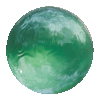
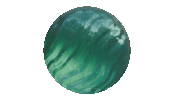
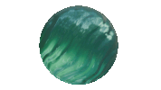
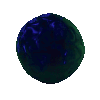

<!DOCTYPE html>

<html>

<head>

<meta name="viewport" content="width=device-width, initial-scale=1.0">
  
</head>

<body>

<h1>

About the Project
  
</h1>

Here is where I will be uploading 3D material assets made in Blender. Mostly, they're procedural. This repository has the .blend files of each material, a .gltf export, and .gif images of the spheres in the files. Check the license!
  

  

</body>

</html>
