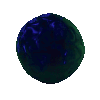
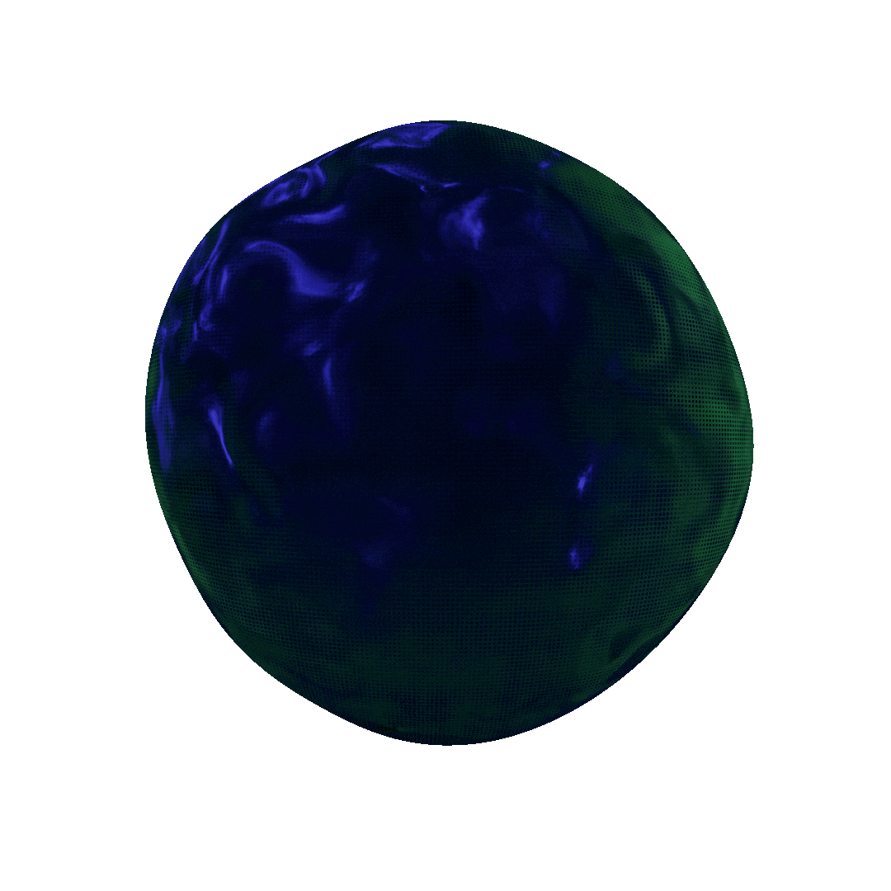

<!DOCTYPE html>

<html>

<head>

<meta name="viewport" content="width=device-width, initial-scale=1.0">
  
</head>

<body>

  

<h1>

Iridescent Cyber Slime
  
</h1>

This is a procedural texture made in Blender. It's velvety, swirly and it has a neon green crosshatch for a futuristic touch.
  

</body>

</html>
